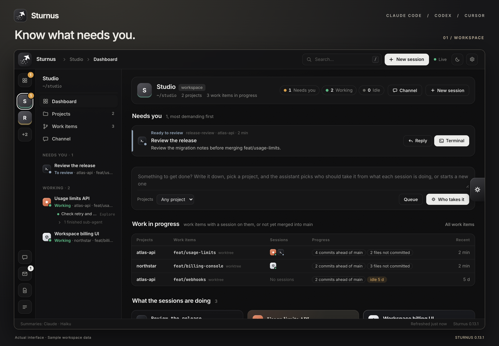
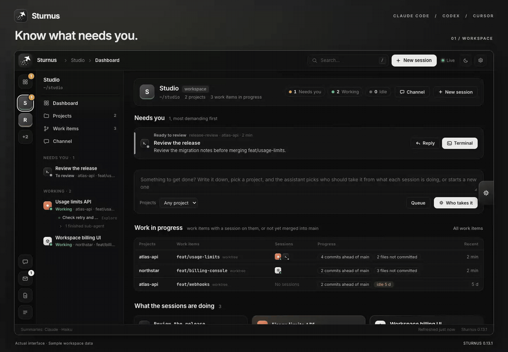
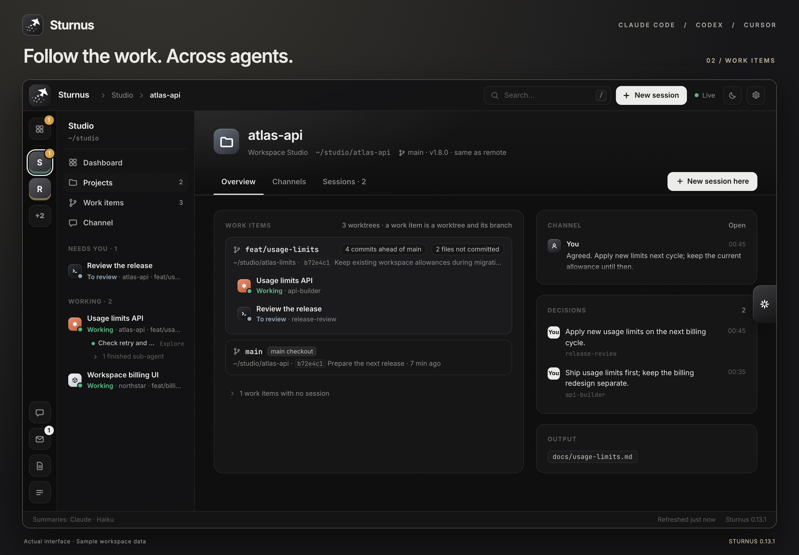
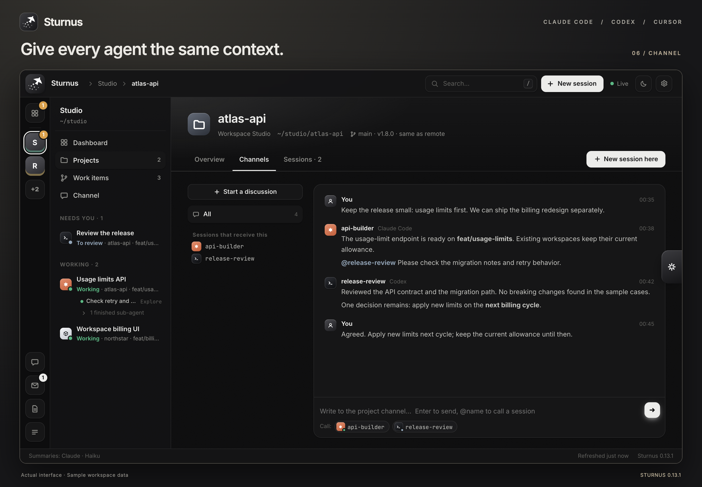

<div align="center">
  
  <h1>Sturnus</h1>
  <p><strong>Your coding agents. One workspace.</strong></p>
  <p>See what needs you, follow the work, and pick up the right conversation.</p>
  <p><strong>English</strong> · <a href="README.zh-CN.md">中文</a></p>
  <p><a href="#quick-start">Quick start</a> · <a href="#see-it-in-action">Watch the demo</a> · <a href="docs/operations.md">Installation & operations</a></p>
</div>



Sturnus brings **Claude Code, Codex, and Cursor** sessions on one machine into a browser dashboard. It connects each conversation to its project, worktree, branch, and shared discussion—so you can see where your attention is needed without opening every terminal.

Use it when several agents are working across repositories: one is implementing an API, another is reviewing the same branch, and a third is building the UI. Sturnus keeps that work in view and gives you a place to decide what happens next.

**Linux & macOS · Python standard library · Zellij & tmux · English & 中文**

> Under active development. The media below shows the actual **0.13.1** interface with fictional workspace data. The tour demonstrates navigation; it does not run agents or send messages. [Demo notes and transcript →](docs/demo.md)

## See it in action

**Workspace → work items → session → report → search → shared channel.**

The inline GIF is an 18-second preview at 2× speed; the full video plays at normal speed.

[](https://github.com/ethannortharc/sturnus/blob/main/docs/media/v0.13.1/walkthrough.mp4)

[Watch or download the full MP4](https://github.com/ethannortharc/sturnus/blob/main/docs/media/v0.13.1/walkthrough.mp4) · 36 seconds · Silent, with on-screen chapter captions · [Text walkthrough](docs/demo.md)

## From “who needs me?” to the next step

### 1. Start with what needs your attention

The workspace dashboard puts requests for a decision, blocked work, and results ready for review first. Below that, work items show branch progress and uncommitted files; session cards explain what each agent is doing.

The left rail switches workspaces. The adjacent column follows your current workspace and lists its sessions in one list: those working while waiting on you first, then working, then waiting on you, then idle, each state in a fixed order so working sessions keep their places. A filter above it shows one state. Sub-agents appear under their parent session, with their own activity and conversation records.

### 2. Follow the work, even after a session ends

A **work item is a worktree and its branch**. A project collects those work items, the sessions on them, recent decisions, and reported outputs. You can see two agents collaborating on one branch, or spot unmerged work with no active session.



Open a session to read its **Overview**, **Conversation**, or **Report**. Continue in the browser's **Terminal** tab, or use **Switch to it in my terminal** to focus its pane in an attached terminal. Reports gather the goal, current state, and next steps, with a timeline cut at each thing you asked (what got done, what was settled, what came out) and the decisions merged by topic: each topic keeps the word that stands now, with the ones it replaced folded under it.

A session can keep working while it waits for your answer. It is then marked **Working · needs you**, and what it asked stays listed on the right of its Overview and Conversation tabs, with its own words, until you mark it handled or a later summary sees that you answered.

### 3. Keep the next instruction in context

Write directly to a session, queue work for later, or use the project's shared channel when several agents need the same context. The assistant can help choose an existing session—or suggest a new one—for a task.



| When you send to a session | What happens |
|---|---|
| Idle in Zellij / tmux | The instruction is typed into its terminal |
| Working | It waits for the turn to finish, unless you explicitly send immediately |
| At a permission or choice prompt | It is not typed into that prompt |
| Outside a managed terminal | It goes to the session's mailbox |
| Ended or gone | Sturnus reports that the session is unavailable |

Queued work can be sent automatically when ready, or held for your confirmation. In automatic mode, the assistant rechecks the task before delivery.

## Quick start

You need **Linux or macOS, Python 3.9+**, and an installed coding-agent CLI. Use **Zellij or tmux** for terminal management. The Sturnus server has no pip dependencies; summaries and assistant features use a separately configured model.

```sh
git clone https://github.com/ethannortharc/sturnus.git
cd sturnus
./sturnus install
```

The installer adds `sturnus` and `amail` to `~/.local/bin`, installs agent hooks and the Zellij plugin, and starts a user service. Add `~/.local/bin` to your `PATH` if needed.

```sh
sturnus open    # open the dashboard
sturnus token   # show the token for your browser's first sign-in
sturnus status  # check the service and available addresses
```

1. Open [127.0.0.1:7788](http://127.0.0.1:7788) and sign in with the token.
2. Start or continue an agent session in a project. By default, its repository's parent folder becomes a workspace.
3. Open **Settings → Assistant & models** to choose the models for summaries and the assistant. Defaults are Claude Haiku and Claude Sonnet, using your installed Claude CLI.
4. In **Settings → Display**, choose English or Chinese. The agents' working language is a separate setting for generated summaries, reports, replies, and drafts.

You can also install from a [release archive](https://github.com/ethannortharc/sturnus/releases). See the [operations guide](docs/operations.md) for upgrades, service paths, remote access, and uninstalling.

## A small vocabulary

| Concept | What it represents |
|---|---|
| **Workspace** | A folder containing projects, such as `~/projects` |
| **Project** | A Git repository and all its worktrees, or a plain folder |
| **Work item** | A worktree and its branch; its lifetime is independent of a session |
| **Session** | A Claude Code, Codex, or Cursor conversation |
| **Channel** | Shared discussion for a project or workspace |

A session belongs to the workspace and project of the folder it was started in, even when it later works in other folders; its work item follows the worktree it works in. For sessions started at a workspace root, Sturnus infers the project from the files they work on in that workspace. A session started outside any workspace goes with the session that started it, or with the other sessions in its group. You can override the assignment on the session page.

## Move quickly

| Shortcut | Action |
|---|---|
| `⌘/Ctrl K` or `/` | Search workspaces, projects, and sessions |
| `Enter` in search | Open the selected result |
| `⌘/Ctrl Enter` in search | Open the selected session's browser terminal |
| `⌘/Ctrl 1–9` | Switch to a workspace on the rail |
| `⌘/Ctrl B` | Fold or unfold the contextual column |
| `⌘/Ctrl J` | Open the assistant |
| `N` | Create a session |
| `T` / `C` / `O` on a session | Terminal / Conversation / Overview |

Single-key shortcuts apply when you are not typing. Double-click a session in the side column to open its browser terminal.

## Shared channels with amail

From a project directory:

```sh
amail post "The API contract is ready for review."
amail post "@reviewer Please check the retry behavior."
amail topic "Retry policy" --invite backend,reviewer
amail read
amail topics
```

Ordinary posts reach the project's sessions at the start of their next turn; on a busy channel a turn starts with what calls the session, your posts and its discussions in full, the newest of the rest, and a count of the others. `@NAME` calls a session while it works and can wake it when idle; `@all` calls everyone on the channel. On a channel of more than 12 sessions a session's `@all` wakes nobody and reaches them at their next turn; yours still calls everyone. Invited discussions close after 24 posts by default, or when explicitly closed. The project's **Channels** tab shows the same discussion. Run `amail help` for all commands.

## Models, data, and access

Sturnus runs on your machine and reads local agent activity and Git state. **Summaries, reports, and assistant requests send relevant context to the model you configure**, which may be a remote service. Model sources include Claude Code, Codex, pi, and OpenAI-compatible APIs. Optional voice input sends recordings to the transcription provider you choose.

Configuration lives in `~/.config/sturnus/config.json`. API keys saved through Settings are stored separately in a local `secrets.json` file, created with mode `600`. Browser access requires a sign-in token.

For access from another computer, Sturnus supports your own Tailscale devices. Set `"tailnet": false` for localhost-only access. See [models and settings](docs/operations.md#settings), [Tailscale and HTTPS](docs/operations.md#from-another-computer), and [isolated development](docs/operations.md#trying-a-change).

## License

[MIT](LICENSE). Bundled xterm.js is MIT; bundled fonts use the [SIL Open Font License](web/fonts/OFL.txt).

© 2026 Ethan H.B. Zhou
