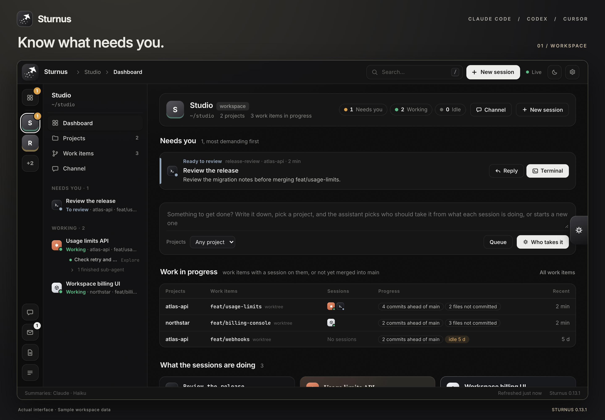
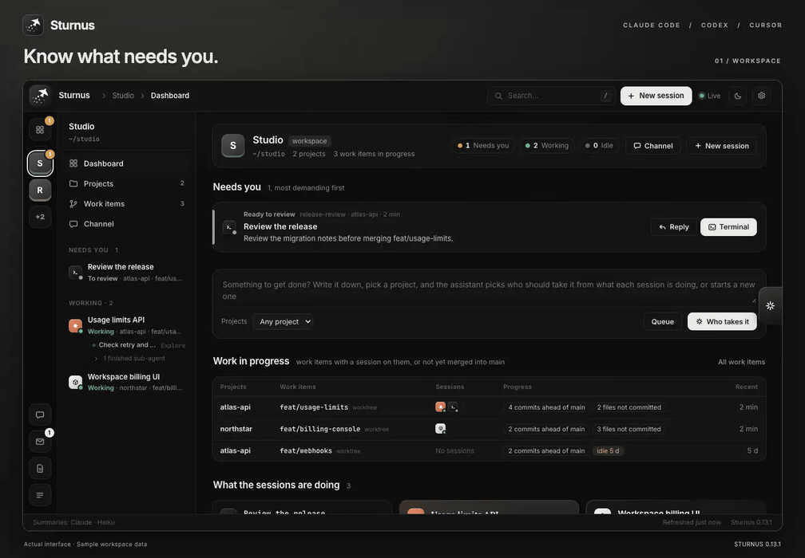
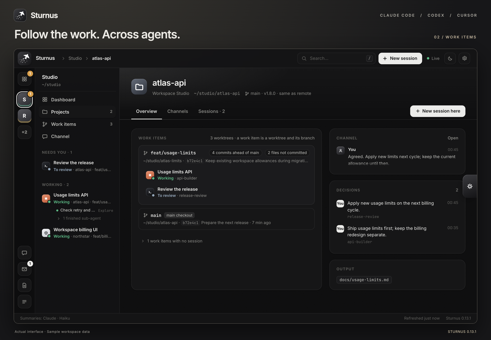
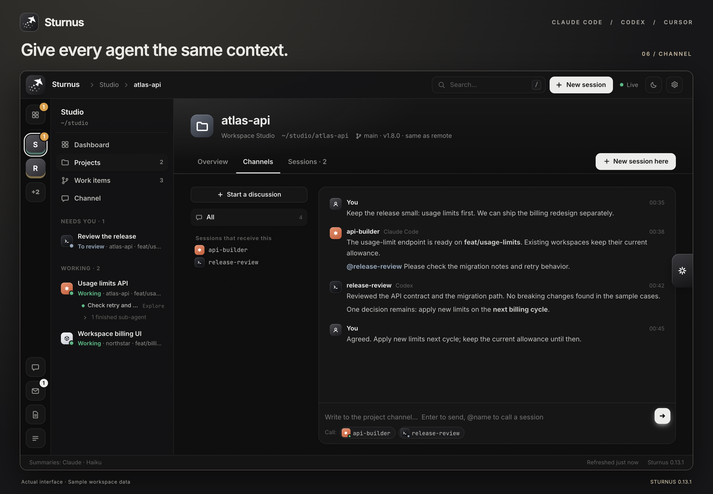

<div align="center">
  
  <h1>Sturnus</h1>
  <p><strong>Your coding agents. One workspace.</strong></p>
  <p>See what needs you, follow the work, and pick up the right conversation.</p>
  <p><strong>English</strong> · <a href="README.zh-CN.md">中文</a></p>
  <p><a href="#quick-start">Quick start</a> · <a href="#see-it-in-action">Watch the demo</a> · <a href="docs/operations.md">Installation & operations</a></p>
</div>



Sturnus brings **Claude Code, Codex, and Cursor** sessions on one machine into a browser dashboard. It connects each conversation to its project, worktree, branch, and shared discussion—so you can see where your attention is needed without opening every terminal.

Use it when several agents are working across repositories: one is implementing an API, another is reviewing the same branch, and a third is building the UI. Sturnus keeps that work in view and gives you a place to decide what happens next.

**Linux & macOS · Python standard library · Zellij & tmux · English & 中文**

> Under active development. The media below shows the actual **0.13.1** interface with fictional workspace data. The tour demonstrates navigation; it does not run agents or send messages. [Demo notes and transcript →](docs/demo.md)
>
> Since **0.23** the desktop page is laid out around sessions that last: one sidebar of workspaces and sessions, and a page for each session ([what changed](#sessions-that-last-in-workspaces-of-your-own)). The media predates that; the pages it shows are all still there, arranged differently.

## See it in action

**Workspace → work items → session → report → search → shared channel.**

The inline GIF is an 18-second preview at 2× speed; the full video plays at normal speed.

[](https://github.com/ethannortharc/sturnus/blob/main/docs/media/v0.13.1/walkthrough.mp4)

[Watch or download the full MP4](https://github.com/ethannortharc/sturnus/blob/main/docs/media/v0.13.1/walkthrough.mp4) · 36 seconds · Silent, with on-screen chapter captions · [Text walkthrough](docs/demo.md)

## From “who needs me?” to the next step

### 1. Start with what needs your attention

The workspace dashboard opens with **What is under way**: the assistant groups the sessions by the thing they work on, says where each thing stands, and lists its sessions with how they stand and when they last moved; a click opens a session, or its terminal. Requests for a decision, blocked work, and results ready for review come next. Below that, work items show branch progress and uncommitted files; session cards explain what each agent is doing.

The left rail switches workspaces. The adjacent column follows your current workspace and lists its sessions in one list: those working while waiting on you first, then working, then waiting on you, then idle, each state in a fixed order so working sessions keep their places. A filter above it shows one state. Sub-agents appear under their parent session, with their own activity and conversation records.

### 2. Follow the work, even after a session ends

A **work item is a worktree and its branch**. A project collects those work items, the sessions on them, recent decisions, and reported outputs. You can see two agents collaborating on one branch, or spot unmerged work with no active session.



Open a session to read its **Conversation** or its **Overview** (what it is doing, its report, what was settled by topic, its timeline; what the session is and where it runs are beside the page, under About it). Continue in the browser's **Terminal** tab, or use **Switch to it in my terminal** to focus its pane in an attached terminal. What you copy in the browser's terminal lands on the computer you are browsing from: a mouse selection in Zellij, tmux's copy mode, and Claude Code's own copy all reach its clipboard (a Zellij with `copy_command` set copies on its own machine only). Drag with ⌥ held (⇧ on other systems) to select in the page itself, then press ⌘C. Reports gather the goal, current state, and next steps, with a timeline cut at each thing you asked (what got done, what was settled, what came out) and the decisions merged by topic: each topic keeps the word that stands now, with the ones it replaced folded under it.

A session can keep working while it waits for your answer. It is then marked **Working · needs you**, and what it asked stays listed on the right of its Overview and Conversation tabs, with its own words, until you mark it handled or a later summary sees that you answered.

### 3. Keep the next instruction in context

Write directly to a session (Enter sends, Shift+Enter makes a new line; a session at work gets your words typed into its terminal at once, and they are in its conversation where they took effect), queue work for later, or use the project's shared channel when several agents need the same context. The assistant can help choose an existing session—or suggest a new one—for a task.



| When you send to a session | What happens |
|---|---|
| Idle in Zellij / tmux | The instruction is typed into its terminal |
| Working | It waits for the turn to finish, unless you explicitly send immediately |
| At a permission or choice prompt | It is not typed into that prompt |
| Outside a managed terminal | It goes to the session's mailbox |
| Ended or gone | Sturnus reports that the session is unavailable |

Queued work can be sent automatically when ready, or held for your confirmation. In automatic mode, the assistant rechecks the task before delivery.

## Quick start

You need **Linux or macOS, Python 3.9+**, and an installed coding-agent CLI. Use **Zellij or tmux** for terminal management. The Sturnus server has no pip dependencies; summaries and assistant features use a separately configured model.

```sh
git clone https://github.com/ethannortharc/sturnus.git
cd sturnus
./sturnus install
```

The installer adds `sturnus` and `amail` to `~/.local/bin`, installs agent hooks and the Zellij plugin, and starts a user service. Add `~/.local/bin` to your `PATH` if needed.

```sh
sturnus open    # open the dashboard
sturnus token   # show the token for your browser's first sign-in
sturnus status  # check the service and available addresses
```

1. Open [127.0.0.1:7788](http://127.0.0.1:7788) and sign in with the token.
2. Start or continue an agent session in a project. By default, its repository's parent folder becomes a workspace.
3. Open **Settings → Assistant & models** to choose the models for summaries and the assistant. Defaults are Claude Haiku and Claude Sonnet, using your installed Claude CLI and the sign-in your Claude Code sessions keep fresh in `~/.claude/.credentials.json` (on macOS the service would otherwise read the login keychain, which sessions inside Zellij cannot reach).
4. In **Settings → Display**, choose English or Chinese. The agents' working language is a separate setting for generated summaries, reports, replies, and drafts.

You can also install from a [release archive](https://github.com/ethannortharc/sturnus/releases). See the [operations guide](docs/operations.md) for upgrades, service paths, remote access, and uninstalling.

## A small vocabulary

| Concept | What it represents |
|---|---|
| **Workspace** | A folder containing projects, such as `~/projects` |
| **Project** | A Git repository and all its worktrees, or a plain folder |
| **Work item** | A worktree and its branch; its lifetime is independent of a session |
| **Session** | A Claude Code, Codex, or Cursor conversation |
| **Channel** | Shared discussion for a project or workspace |

A session belongs to the workspace and project of the folder it was started in, even when it later works in other folders; its work item follows the worktree it works in. For sessions started at a workspace root, Sturnus infers the project from the files they work on in that workspace. A session started outside any workspace goes with the session that started it, or with the other sessions in its group. You can override the assignment on the session page.

## Move quickly

| Shortcut | Action |
|---|---|
| `⌘/Ctrl K` or `/` | Search workspaces, projects, and sessions |
| `Enter` in search | Open the selected result |
| `⌘/Ctrl Enter` in search | Open the selected session's browser terminal |
| `⌘/Ctrl 1–9` | Switch to a workspace on the rail |
| `⌘/Ctrl B` | Fold or unfold the contextual column |
| `⌘/Ctrl J` | Open the assistant |
| `N` | Create a session |
| `T` / `C` / `O` on a session | Terminal / Conversation / Overview |
| `Enter` in a box of words for a session | Send them (`Shift Enter`: a new line) |

Single-key shortcuts apply when you are not typing. Double-click a session in the side column to open its browser terminal.

## Sessions that last, in workspaces of your own

From 0.23 a session in Sturnus is yours, not a process's: one thing you are getting done with an agent. It outlasts the
terminal it runs in and the agent's own conversation.

- **A session keeps going.** Close its tab, restart the machine: it stays in the sidebar, stopped, with its whole
  conversation. **Go on** opens a new terminal and resumes the agent's own conversation (`claude --resume`,
  `codex resume`). Its page shows the conversation in one piece, with a line where the terminal changed, and lists the
  terminals it has run in and why each ended. Sessions the last restart ended are offered once, to go on together.
- **Any agent started anywhere is a session.** One you start by hand in a terminal is picked up the same way, and
  conversations already on disk are listed as stopped sessions you can take up again.
- **Workspaces are yours.** A workspace is a name and the folders it covers. A session belongs to the workspace whose
  folder it was opened in; the sidebar groups by workspace, or shows one list. The workspaces Sturnus used to find by
  itself are carried over once.
- **The sidebar is yours to arrange.** Group the sessions by workspace, by how they stand, by agent or by day, or
  not at all, and order them by who needs you, by last activity, by when they were made, or by name. A workspace folds
  shut to its name and counts; the whole sidebar folds to a strip of icons (⌘B), never out of sight.
- **A session's mark says how it stands.** At work, the mark keeps its agent's color, a green ring turns around it,
  and its row says Working. At rest it goes pale; stopped, only a dashed outline is left. One that needs you keeps
  its color and carries a badge: `!` when it waits for you, a tick when there is something to review, a cross when
  it is stuck.
- **What you send shows at once.** Enter sends. Words sent from a session's page are under its conversation before
  they have left, with how they went (typed into its terminal, put in its mailbox); the conversation in sight is read
  again about every second while its agent works. Words for a session at work are typed into its terminal at once, not
  held until its turn ends: the agent's own command line hands them over at its next step, and they sit in the
  conversation where they took effect, with what the agent did next after them.
- **All of a conversation is there.** The page opens on the last of it; **Show earlier words** brings in what came
  before, as far back as the session's beginning. Sturnus keeps its own copy of what was said (the words you sent
  mid-turn too), so a session's history outlasts its terminal, a restart of the machine, and the agent's own files.
- **A session at rest gives its terminal back.** One nobody has used for seven days (Settings → Terminals; any number of days, or never) has its terminal closed, so idle agents do not pile up in memory; it stays in the list and goes on in a new terminal when you take it up again. A session running where the page cannot reach it (a plain terminal window, the Codex desktop app) says so on its Terminal tab and can be brought into a terminal here.
- **A session says what it runs on.** Its head shows the model, the effort and whether fast mode is on, read from the agent's own conversation file. For a Claude Code session at its prompt, a menu there changes them by typing `/model`, `/effort` or `/fast` into its terminal (Claude Code keeps a model and an effort set this way as your default, and bills fast mode from usage credits; the menu says so).
- **A session's page remembers.** Its conversation, how far you had read, the steps and diffs you had opened and the words you had begun are there when you come back from another session. While its agent works, a line under the conversation says so, with what it is doing and for how long. The side panel is as wide as you drag it.
- **A terminal is only where a session runs.** New terminals open as a tab in the workspace's Zellij group, a window in
  its tmux group, or a tmux session of its own (Settings → Terminals; change it at any time, nothing is moved).
  `sturnus ls` lists the sessions; `sturnus open NUMBER|TITLE` takes the terminal you are in to that session, and gives a
  stopped one a new terminal first.
- **Another agent can take a session on.** Stop it, pick the other agent, and Sturnus writes a handover (what the
  session is for, what was settled, the last words, a file with everything said) that you can change before it is sent.
  The other agent's context is not moved: the note and the file are how it picks up.
- **A worktree of its own.** A new session can get a branch and folder under the repository's `.claude/worktrees/`;
  its page shows what it changed against main, and merges it back (fast-forward only) and clears it away when done.
- **By the clock.** Something set for every day, weekdays, or every few hours starts a new session each time.
- **Archiving is by hand**, as in Codex and Claude Desktop: nothing is archived by time. Archiving a running session
  stops it; only an archived one can be deleted (the agents' own conversation files are never touched).

Sturnus still never owns an agent: each runs as its own CLI in a terminal, and you can always work there directly.

## Tasks that outlast the sessions

A session is temporary; what it was working toward is not. Each project and workspace keeps a list of tasks, as lists and cards on the **Tasks** page, on the project's page and on the workspace dashboard. Each says where it stands, where to pick it up, what was settled, what came out of it, and which sessions worked on it. A task shows as under way while a session works on it, and as ready to pick up once that session ends.

- Start a new session from a task, give it to a running one, or pick one from a session's page.
- Sessions keep their tasks up to date with `amail task`, and hear of the open ones when they start.
- The assistant fills in what they leave out from each session's report, without overwriting you, and tidies the list as it grows.
- A task is to do, under way, waiting on you, put aside, done or dropped, and the page groups the list by project or by state. One nobody is on and that waits on nobody is **put aside**; anything can be **archived**, which takes it out of the lists but not out of the search.
- The list tidies itself: a task that waited on you for seven days with no session left on it is put aside, one ended for seven days or put aside for thirty is archived, and one button puts aside everything that waits on you with nobody there to hear the answer.
- Search covers tasks, decisions and results, ended ones too. Updates replace what was there, so the store stays small. See [Tasks in the operations guide](docs/operations.md#tasks).

## Shared channels with amail

From a project directory:

```sh
amail post "The API contract is ready for review."
amail post "@reviewer Please check the retry behavior."
amail topic "Retry policy" --invite backend,reviewer
amail read
amail topics
```

Ordinary posts reach the project's sessions at the start of their next turn; on a busy channel a turn starts with what calls the session, your posts and its discussions in full, the newest of the rest, and a count of the others. `@NAME` calls a session while it works and can wake it when idle; `@all` calls everyone on the channel. On a channel of more than 12 sessions a session's `@all` wakes nobody and reaches them at their next turn; yours still calls everyone. Invited discussions close after 24 posts by default, or when explicitly closed. The project's **Channels** tab shows the same discussion. Run `amail help` for all commands.

## Answering from a phone

`/api/phone/summary` and `/api/phone/inbox` list what waits on you: a session stopped at a permission prompt, at a question, or waiting for your words. `POST /api/phone/actions/<id>` with `{"choice": …, "text": …}` answers one of them, with the same sign-in as the page, so a phone app that opens the page can also list and answer them on its own screen.

- A permission prompt shows what it is for (the command, the file, the address) and can be allowed or denied: Allow presses `1` (always the first choice, Yes), Deny presses Esc. Choices that change lasting rules, such as always allowing or switching to auto mode, stay in the terminal.
- A question with one answer offers its options; several questions, several answers, a plan to approve and Codex prompts can only be opened.
- Keys are offered only while Claude Code itself says the session waits, in the pane its process runs in now, with one prompt open. An answer names the very prompt it was shown and is checked again the moment before the keys go; once that prompt is answered (here or in the terminal) or replaced, the answer is refused, and so is a second answer to the same item, so a late tap types nothing.
- Words for a waiting session go the way the page sends them: typed when it is idle, held while it works, mailed when it is in no pane.

On a screen under 640 px wide (a phone) the page has a layout of its own: one list on the home page (what needs you, with a prompt's Allow and Deny right there; what is under way, by workspace; idle sessions, open tasks and all workspaces folded), every other place in a menu, and a session page with its head and a reply line fixed. Its terminal tab only looks: it shows the agent's own pane as it is, refreshed every two seconds, with no client attached, so the desktop's layout keeps its size; taking the terminal over to type is a separate step that says so.

### Pairing a phone app with several machines

Each machine runs its own Sturnus, which sees every session on that machine. A phone app can join several of them into one list. **Settings → Access → Pair a phone** shows a QR code and an eight-letter code, good for ten minutes and once; on a machine reached only by ssh, `sturnus pair` prints the code and the address. The app sends the code to `POST /api/app/pair` and gets a key of its own, which it sends as `Authorization: Bearer` from then on.

- The key is kept as a hash beside the signed-in browsers, listed in Settings → Access, and can be removed there; `sturnus token --rotate` signs out phones as well as browsers. Only your own Tailscale devices are let in, as for the page.
- A phone's key reaches what a phone needs (the app's view, the screen, the conversation, the actions) but not the access settings.
- `GET /api/app/state?after=<rev>&wait=25` answers as soon as anything it shows changes, or after 25 seconds unchanged: the live sessions with how each stands (a sub-agent names the session that started it), what waits on you with the answers a phone may give, the groups and recent folders for starting a new session; the sessions that last, running or stopped, with how each stands, and the workspaces you keep with their folders; what runs by the clock, the sessions a restart ended, the agents a new session can be; each workspace's dashboard overview and its projects, each project with its work items; the tasks, those put aside too; the channels with what is new in them; mail to you; push locks left behind. A session stirring alone is no news.
- `GET /api/app/session?kept=<id>` is one session's page: what it is and the terminals it has run in, what it asked of you, its report and its timeline, the tasks it is on, the sub-agents it started, the messages to and from it. Its conversation is `GET /api/transcript?kept=<id>`, as the page reads it. (`?id=<row>` gives the same for a running row, for an app that knows only those.)

## Models, data, and access

Sturnus runs on your machine and reads local agent activity and Git state. **Summaries, reports, and assistant requests send relevant context to the model you configure**, which may be a remote service. Model sources include Claude Code, Codex, pi, and OpenAI-compatible APIs. Optional voice input sends recordings to the transcription provider you choose.

Configuration lives in `~/.config/sturnus/config.json`. API keys saved through Settings are stored separately in a local `secrets.json` file, created with mode `600`. Browser access requires a sign-in token.

For access from another computer, Sturnus supports your own Tailscale devices. Set `"tailnet": false` for localhost-only access. See [models and settings](docs/operations.md#settings), [Tailscale and HTTPS](docs/operations.md#from-another-computer), and [isolated development](docs/operations.md#trying-a-change).

## License

[MIT](LICENSE). Bundled xterm.js is MIT; bundled fonts use the [SIL Open Font License](web/fonts/OFL.txt).

© 2026 Ethan H.B. Zhou
