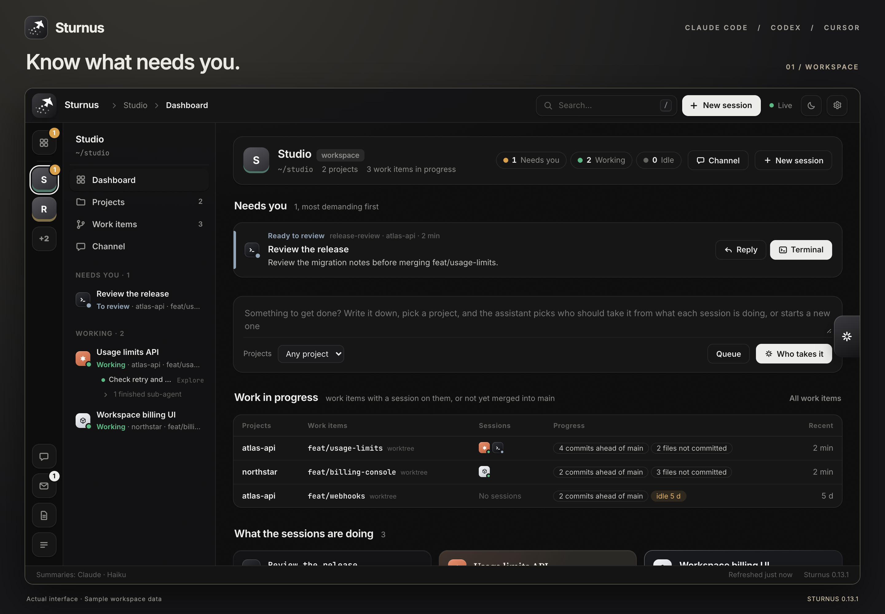
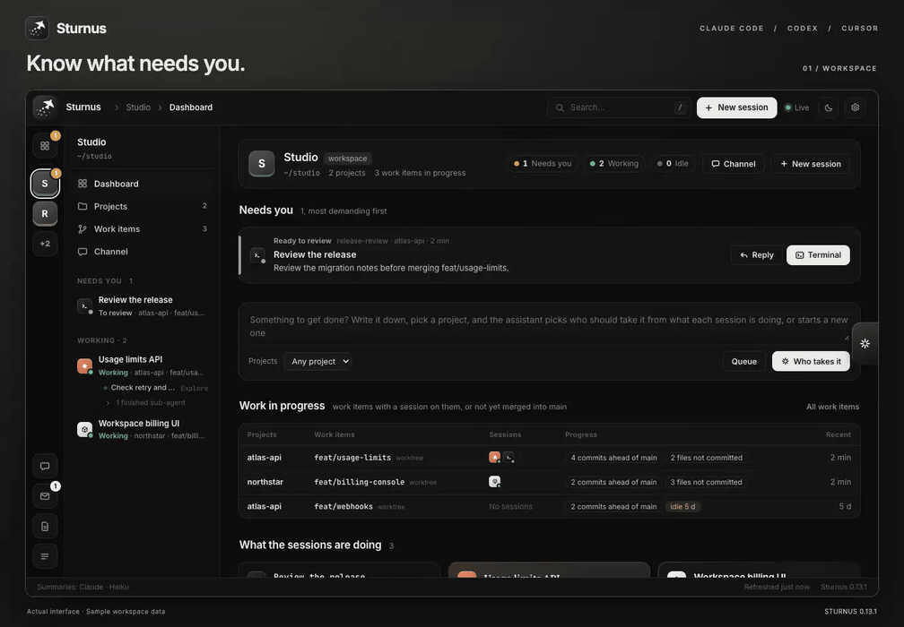
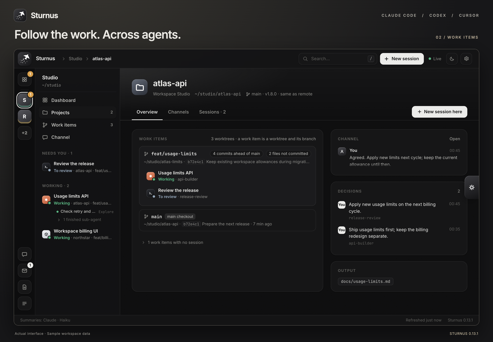
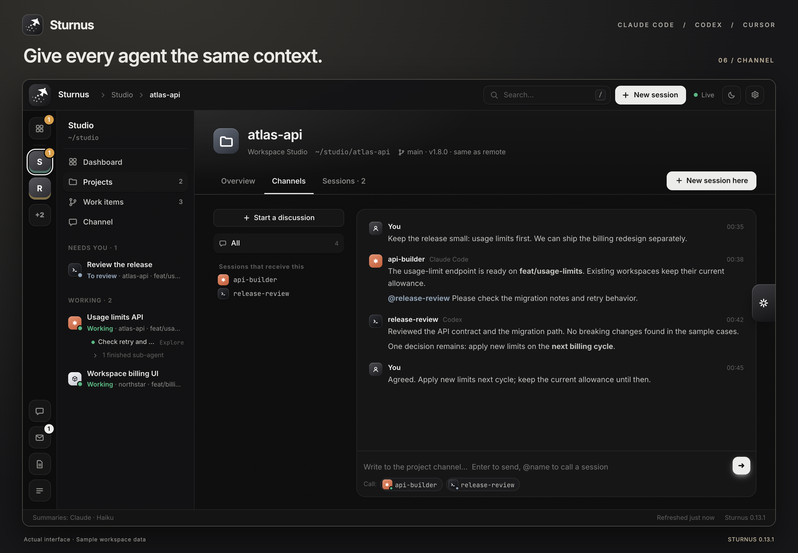

<div align="center">
  
  <h1>Sturnus</h1>
  <p><strong>多个编码 Agent，一个工作区。</strong></p>
  <p>看清谁在等你、工作做到哪里，随时接上正确的对话。</p>
  <p><a href="README.md">English</a> · <strong>中文</strong></p>
  <p><a href="#快速开始">快速开始</a> · <a href="#看看实际操作">操作演示</a> · <a href="docs/operations.md">安装与运维</a></p>
</div>



Sturnus 把同一台机器上的 **Claude Code、Codex 和 Cursor** 会话集中到一个浏览器界面，将对话与项目、worktree、分支和共享讨论关联起来。不用逐个打开终端，就能找到需要你处理的事情。

当几个 Agent 同时在不同仓库里工作——一个实现 API，一个检查同一条分支，另一个开发界面——Sturnus 帮你看清它们的进展，并接着安排下一步。

**Linux 与 macOS · Python 标准库 · Zellij 与 tmux · 中英文界面**

> 项目仍在积极开发中。以下素材来自 **0.13.1 的真实界面**，使用虚构的示例工作区数据。演示展示页面操作，不运行 Agent，也不发送消息。[演示说明与文字版 →](docs/demo.md)
>
> 从 **0.23** 起，桌面页面改成围绕「一直留着的会话」来排：一条列出工作区和会话的侧栏，每条会话一个自己的页面（[改了什么](#会话一直留着归在你自己的工作区里)）。下面的素材早于这次改动；素材里的页面都还在，只是排法不同。

## 看看实际操作

**工作区 → 工作项 → 会话 → 报告 → 搜索 → 项目讨论。**

下方 GIF 为 18 秒的 2 倍速预览，完整视频按正常速度播放。

[](https://github.com/ethannortharc/sturnus/blob/main/docs/media/v0.13.1/walkthrough.mp4)

[观看或下载完整 MP4](https://github.com/ethannortharc/sturnus/blob/main/docs/media/v0.13.1/walkthrough.mp4) · 36 秒 · 无声，附画面章节说明 · [文字版操作路线](docs/demo.md)

## 从「谁在等我」到下一步行动

### 1. 先看需要你处理的事

工作区仪表盘最上面是**现在在做的事**：助手按在做的事把会话归在一起，说明每件事做到哪一步，列出做这件事的会话、它们的状态和最后动静，点一下进入会话或它的终端。接下来是等待决定、遇到阻碍和需要验收的工作。下方的工作项展示分支进度和未提交文件，会话卡片说明每个 Agent 正在做什么。

最左侧切换工作区，相邻的一栏跟随当前工作区，把会话排成一个列表：工作中且等你确认的在最前，其次是工作中，再其次是等你，最后是空闲；同一状态里顺序固定，工作中的会话不会换来换去。列表上方可以筛选只看某一种状态。子 Agent 列在所属会话下面，可以查看它们的活动和对话记录。

### 2. 会话结束，工作仍然可追踪

一个**工作项就是一个 worktree 和它的分支**。项目页面将工作项、参与会话、最近的决定和报告中的产出放在一起。你既能看到两个 Agent 正在同一条分支上协作，也能找到已经没有会话、却还没合并的工作。



打开会话后，可以阅读**对话**和**概览**（现在在做什么、报告、按主题整理的决定、时间线；会话本身的信息在页面右侧的「会话信息」里），通过**终端**标签继续操作，或用**在本机终端里切过去**切换到已连接终端中的对应窗格。在网页终端里复制的内容会进你正在浏览的这台电脑的剪贴板：Zellij 里用鼠标选中、tmux 的复制模式、Claude Code 自己的复制都算（Zellij 配了 `copy_command` 的话，只复制到它所在的机器）。按住 ⌥（其他系统按 ⇧）拖动，可以直接在网页里选中，再按 ⌘C 复制。报告汇总目标、当前状态和下一步，附一条按你每次要求分段的时间线（做成了什么、定下了什么、产出了什么），以及按主题归并的决定：每个主题只留现在算数的结论，被它推翻的旧说法收在下面。

会话可以一边接着干活、一边等你回答。这时它标成**工作中 · 等你确认**，它问你的事连同原话一直列在概览和对话页的右侧，直到你点「已处理」，或者它之后的总结看出你已经回应。

### 3. 把下一条指令放在正确的位置

直接给一个会话写指令，把工作排到稍后，或者在项目讨论区给多个 Agent 补充共同的背景。助手可以根据各会话正在做的事，建议由谁接手，或是否新建一个会话。



| 给会话发送指令时 | 处理方式 |
|---|---|
| 在 Zellij / tmux 中空闲 | 输入到对应终端 |
| 正在工作 | 等这一轮结束，除非你明确选择立即发送 |
| 停在权限或选项提示上 | 不会把指令误输入到提示里 |
| 不在托管终端中 | 放入该会话的邮箱 |
| 已结束或离开 | 提示会话不可用 |

排队的工作可以在条件满足后自动发送，也可以先提醒你确认。自动模式下，助手会在发送前重新检查任务是否适合继续。

## 快速开始

需要 **Linux 或 macOS、Python 3.9+**，以及已安装的编码 Agent CLI。终端管理使用 **Zellij 或 tmux**。Sturnus 服务没有 pip 依赖；摘要和助手功能使用单独配置的模型。

```sh
git clone https://github.com/ethannortharc/sturnus.git
cd sturnus
./sturnus install
```

安装程序会把 `sturnus` 和 `amail` 加入 `~/.local/bin`，安装 Agent hooks 与 Zellij 插件，并启动用户服务。请确保 `~/.local/bin` 已加入 `PATH`。

```sh
sturnus open    # 打开仪表盘
sturnus token   # 查看浏览器首次登录需要的令牌
sturnus status  # 查看服务状态与访问地址
```

1. 打开 [127.0.0.1:7788](http://127.0.0.1:7788)，用令牌登录。
2. 在项目里开始或继续一个 Agent 会话。默认情况下，仓库的上级文件夹成为工作区。
3. 在**设置 → 助手与模型**中选择摘要和助手使用的模型。默认通过本机 Claude CLI 分别使用 Haiku 和 Sonnet，用的是 Claude Code 会话自己保持有效的登录 `~/.claude/.credentials.json`（在 macOS 上，后台服务否则会去读登录钥匙串，而 Zellij 里的会话读不到钥匙串，钥匙串里那份就会过期）。
4. 在**设置 → 显示**中选择中英文界面。**Agent 的工作语言**单独设置，决定之后生成的摘要、报告、回答和草稿使用哪种语言。

也可以下载 [Release 压缩包](https://github.com/ethannortharc/sturnus/releases)安装。升级、服务路径、远程访问和卸载见[安装与运维指南](docs/operations.md)。

## 五个概念

| 概念 | 含义 |
|---|---|
| **工作区** | 存放多个项目的文件夹，例如 `~/projects` |
| **项目** | 一个 Git 仓库及其全部 worktree，或一个普通文件夹 |
| **工作项** | 一个 worktree 和它的分支，生命周期独立于会话 |
| **会话** | 一场 Claude Code、Codex 或 Cursor 对话 |
| **讨论区** | 工作区或项目共享的讨论空间 |

会话归属它启动时所在目录的工作区和项目，之后进到别的目录干活也不变；工作项跟着它所在的 worktree 走。会话如果从工作区顶层启动，Sturnus 会根据它在这个工作区里操作的文件推断所属项目。在所有工作区之外启动的会话，跟着启动它的会话，或者它所在组里的其他会话。也可以在会话页面手动调整归属。

## 常用快捷操作

| 快捷键 | 操作 |
|---|---|
| `⌘/Ctrl K` 或 `/` | 搜索工作区、项目和会话 |
| 搜索中按 `Enter` | 打开选中结果 |
| 搜索中按 `⌘/Ctrl Enter` | 打开选中会话的网页终端 |
| `⌘/Ctrl 1–9` | 切换到左侧对应工作区 |
| `⌘/Ctrl B` | 收起或展开相邻一栏 |
| `⌘/Ctrl J` | 打开助手 |
| `N` | 新建会话 |
| 会话页面按 `T` / `C` / `O` | 终端 / 对话 / 概览 |
| 在给会话写话的输入框里按 `Enter` | 发送（`Shift Enter` 换行） |

单键快捷键在没有输入文字时生效。双击侧栏里的会话，也能直接打开它的网页终端。

## 会话一直留着，归在你自己的工作区里

从 0.23 起，Sturnus 里的一条会话是你的一件事，不再等于一个进程。终端关了、agent 自己的对话清空了，会话都还在。

- **会话能接着做。** 关掉它的标签、重启机器，它都留在侧栏里（已停止），整段对话都在。点**继续**会新开一个终端，接上 agent
  自己的那段对话（`claude --resume`、`codex resume`）。会话页把对话连成一条，换终端的地方有一条分隔线；右边列出它用过的终端和
  每个终端结束的原因。机器重启前在跑的会话，会在首页提示一次，可以一起继续。
- **在哪开的 agent 都算会话。** 你在终端里手动开的也会被收进来；磁盘上已有的对话列为已停止的会话，随时可以接着做。
- **工作区由你管。** 一个工作区就是一个名字加上它管的目录。会话开在哪个目录里，就归到管那个目录的工作区；侧栏按工作区分组，
  也可以不分组。Sturnus 以前自己找出来的工作区会迁移一次。
- **侧栏怎么排由你定。** 会话可以按工作区、状态、Agent、时间分组，也可以不分组；排序可以选等你的在前、最近活动、创建时间或名字。
  一个工作区可以整个折叠，只留名字和数量；整条侧栏可以收成一条图标栏（⌘B），不会完全消失。
- **看图标就知道会话的状态。** 在干活：图标是 agent 自己的颜色，外面有一圈绿光在转，这一行右边写着「工作中」。空闲：图标褪成淡色。
  已停止：只剩一个虚线框。要你处理的保持原色，并带一个角标：`!` 是等你，对勾是待验收，叉是卡住了。
- **发出去的话马上能看到。** 回车就是发送。在会话页发的话，还没送到就先显示在对话下面，并写明是怎么送的（打进终端、放进信箱）；
  agent 在工作时，眼前这段对话大约每秒读一次。会话正在工作时发的话也是马上打进它的终端，不再等它这一轮做完：agent 自己的命令行会在
  下一步把话交给它，这句话就排在对话里它生效的位置，后面跟着 agent 接下来做的事。
- **整段对话都在。** 会话页先显示最近的一段，点**显示更早的对话**可以一直翻到会话开头。Sturnus 自己存了一份说过的话（包括你中途插进去的），
  所以终端关了、机器重启了、agent 自己的文件没了，会话的历史都还在。
- **歇着的会话会把终端让出来。** 一条会话 7 天没人用（设置 → 终端 里可以改天数，或者设成从不），它的终端会自动关掉，空闲的 agent 不再占着内存；
  会话留在列表里，下次接着用时新开终端。跑在页面够不着的地方的会话（普通终端窗口、Codex 桌面应用），「终端」标签会说明原因，并可以搬到这里的终端里。
- **会话页头写着它用的模型。** 模型、思考强度、是否快速模式，都从 agent 自己的对话文件里读出来。Claude Code 的会话停在提示符前时，可以在那里点开菜单换：
  实际是往它的终端里输入 `/model`、`/effort` 或 `/fast`（Claude Code 会把这样设的模型和强度存成你的默认设置，快速模式另外按用量计费，菜单里都写明了）。
- **会话页记得你离开时的样子。** 从别的会话切回来，对话、读到哪、打开过的步骤和文件差异、写到一半的话都还在。agent 在工作时，对话下面有一行
  「工作中」，写着在做什么、做了多久。右侧栏可以拖宽。
- **终端只是会话跑的地方。** 新终端可以开成工作区那个 Zellij 组里的一个标签、tmux 组里的一个窗口，或者每条会话自己一个 tmux
  会话（设置 → 终端，随时可以换，什么都不用迁移）。`sturnus ls` 列出会话；`sturnus open 编号或名字` 把你所在的终端带到那条会话，
  已停止的先新开终端再进去。
- **可以换一个 agent 接着做。** 先停止，选另一个 agent，Sturnus 会写一份交接说明（这条会话在做什么、定下了什么、最近说的话、
  一份完整记录文件），发出去之前你可以改。原来那个 agent 的上下文搬不过去，新 agent 靠这份说明和记录文件接上。
- **自己的 worktree。** 新会话可以在仓库的 `.claude/worktrees/` 下单开一个分支和目录；会话页里能看它相对 main 改了什么，做完后
  合并回去（只做快进合并）并清掉。
- **定时。** 设成每天、工作日或每隔几小时的事，到点就开一条新会话去做。
- **归档要手动**，和 Codex、Claude Desktop 一样，不按时间自动归档。归档正在跑的会话会先停掉它；只有归档了的才能删除
  （agent 自己存的对话文件不会动）。

Sturnus 仍然不接管 agent：每个 agent 都是在终端里跑的原生 CLI，你随时可以直接在终端里用。

## 比会话活得久的任务

会话是临时的，它在推进的事不是。每个项目和工作区都有一份任务列表，在**任务**页、项目页和工作区仪表盘上以列表和卡片显示。每个任务记着现状、从哪接着做、定下来的事、产出，以及做过它的会话。有会话在做时显示进行中，会话结束后显示待继续。

- 可以从任务开一个新会话，交给正在运行的会话，也可以在会话页选一个任务。
- 会话用 `amail task` 维护自己的任务，开始时也会收到这个项目没做完的任务。
- 助手从每个会话的报告里补上遗漏，不覆盖你写的内容，列表变长时还会整理。
- 任务的状态有待办、在做、等你、搁置、做完了、不做了，任务页可以按项目或按状态归类。没人在做、也不等谁的任务可以**搁置**；任何任务都可以**归档**，归档后不再出现在各处的列表里，搜索里还找得到。
- 列表会自己整理：等你超过 7 天、又没有会话在做的任务移到搁置；结束 7 天、搁置 30 天后归档。还有一个按钮，把所有「在等你、但已经没有会话在等回答」的任务一起移到搁置。
- 搜索覆盖任务、决定和产出，也包括已结束的。更新是替换原有内容，所以数据不会一直变大。详见[运维文档](docs/operations.md#tasks)。

## 用 amail 共享上下文

在项目目录里运行：

```sh
amail post "API 契约已准备好，可以检查了。"
amail post "@reviewer 请检查重试逻辑。"
amail topic "重试策略" --invite backend,reviewer
amail read
amail topics
```

普通帖子会在项目会话下一轮开始时送达；讨论区很忙时，一轮开始只完整给出点名它的、你发的和它参加的讨论，其余只给最新的几条，再报一个总数。`@名字` 可以在会话工作时提醒它，空闲时唤醒它；`@all` 会提醒整个讨论区。超过 12 个会话的讨论区里，会话发的 `@all` 不再唤醒所有人，等大家下一轮开始时送到；你发的 `@all` 照旧叫所有人。邀请制讨论默认在 24 条帖子后关闭，也可以主动结束。项目的**讨论**标签展示同一份内容。运行 `amail help` 查看全部命令。

## 在手机上处理

`/api/phone/summary` 和 `/api/phone/inbox` 列出等你处理的事：停在确认提示上的会话、停在提问上的会话、等你回话的会话。`POST /api/phone/actions/<id>`（`{"choice": …, "text": …}`）处理其中一项，登录方式和网页相同，所以打开网页的手机 App 也能在自己的界面里列出并处理它们。

- 确认提示会写明它要做什么（命令、文件、网址），可以允许或拒绝：允许按 `1`（总是第一个选项「Yes」），拒绝按 Esc。会改变长期规则的选项，比如「总是允许」或切换到自动模式，只能在终端里选。
- 只有一个答案的提问会给出选项；多个问题、多选、待批准的计划和 Codex 的提示只能打开去处理。
- 只有 Claude Code 自己说这个会话在等、它的进程现在就在那个窗格里、并且只开着一个提示时，才提供按键。每次回答都指明它看到的那个提示，按键发出前再查一次；那个提示已经被回答（在这里或终端里）或换掉了，就拒绝这次回答，同一项的第二次回答也拒绝，所以迟到的点按不会打出任何字。
- 给等着的会话写的话，和网页上一样送达：空闲时直接输入，工作中先存着，不在任何窗格里就发邮件。

屏幕宽度不到 640 px（手机）时，网页换成手机专用的排版：首页是一条列表（需要你的事，确认提示的允许和拒绝就在卡片上；在做的事，按工作区分组；空闲的会话、没做完的任务和所有工作区折叠起来），其他地方都在菜单里；会话页的头部和回复框固定。终端标签只看不打字：它显示 agent 自己那个窗格现在的画面，每两秒刷新，不挂客户端，所以桌面上的布局不会被缩小；要打字就点「接管终端」，这是单独的一步，会先说明后果。

### 手机 App 同时连几台机器

每台机器跑自己的 Sturnus，它看得到那台机器上所有的会话。手机 App 可以把几台机器的会话合成一个列表。**设置 → 访问 → 连一台手机**会显示一个二维码和一个 8 位配对码，10 分钟内有效，只能用一次；只能 ssh 上去的机器，运行 `sturnus pair` 会打印配对码和地址。App 把配对码发给 `POST /api/app/pair`，换到一把它自己的密钥，之后每次请求都用 `Authorization: Bearer` 带上。

- 密钥只存哈希，和已登录的浏览器列在一起（设置 → 访问），可以在那里移出；`sturnus token --rotate` 会让浏览器和手机都退出。和网页一样，只放行你自己 Tailscale 账号下的设备。
- 手机的密钥能用手机需要的（App 的视图、屏幕、对话、各种操作），不能改访问设置。
- `GET /api/app/state?after=<rev>&wait=25` 在它显示的内容一有变化就返回，25 秒没变化也返回：在线的会话和各自的状态（子 agent 标出启动它的会话），等你处理的事和手机能给的回答，新建会话用的组和最近的目录；每个工作区和它仪表盘上的概览、它的项目，每个项目的工作项；任务；各讨论区和里面的新消息；写给你的信；没人管的推送锁。只是某个会话又动了一下，不算变化。
- `GET /api/app/session?id=<id>` 是一个会话的页面：它要你确认的事、它的报告、它在做的任务、它启动的子 agent、它和别的会话之间的消息。

## 模型、数据与访问

Sturnus 在本机运行，读取本地 Agent 活动和 Git 状态。**摘要、报告和助手请求会把相关上下文发送给你配置的模型**，模型可能运行在远程服务上。支持 Claude Code、Codex、pi 和 OpenAI 兼容 API。可选的语音输入会把录音发送给你选择的转写服务。

配置位于 `~/.config/sturnus/config.json`。通过设置页面保存的 API key 单独存放在本地 `secrets.json` 中，创建文件时使用 `600` 权限。浏览器访问需要登录令牌。

需要跨设备使用时，可以通过自己账号下的 Tailscale 设备访问。设置 `"tailnet": false` 可限制为本机访问。详见[模型与设置](docs/operations.md#settings)、[Tailscale 和 HTTPS](docs/operations.md#from-another-computer)、[隔离开发实例](docs/operations.md#trying-a-change)。

## 许可证

[MIT](LICENSE)。内置 xterm.js 使用 MIT；内置字体使用 [SIL Open Font License](web/fonts/OFL.txt)。

© 2026 Ethan H.B. Zhou
