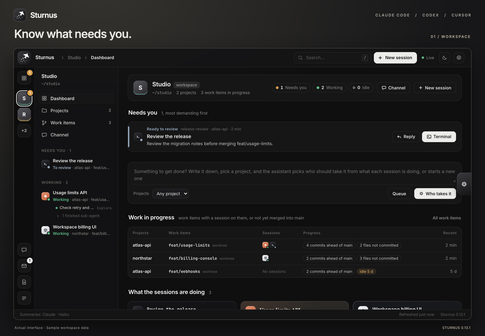
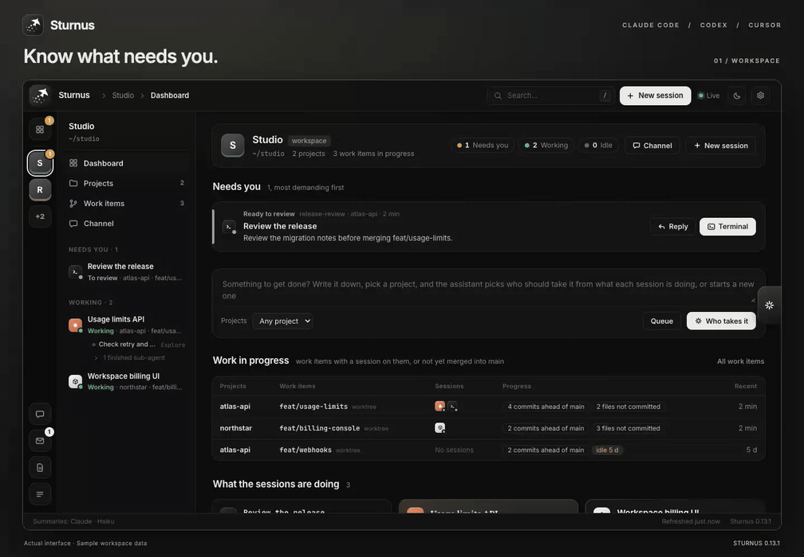
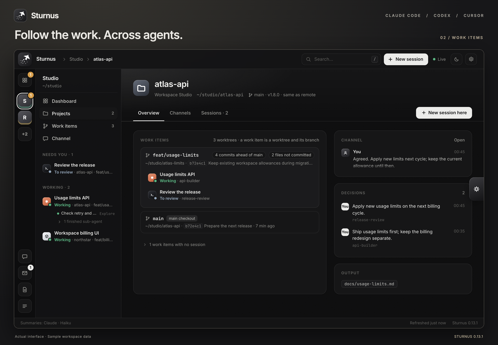
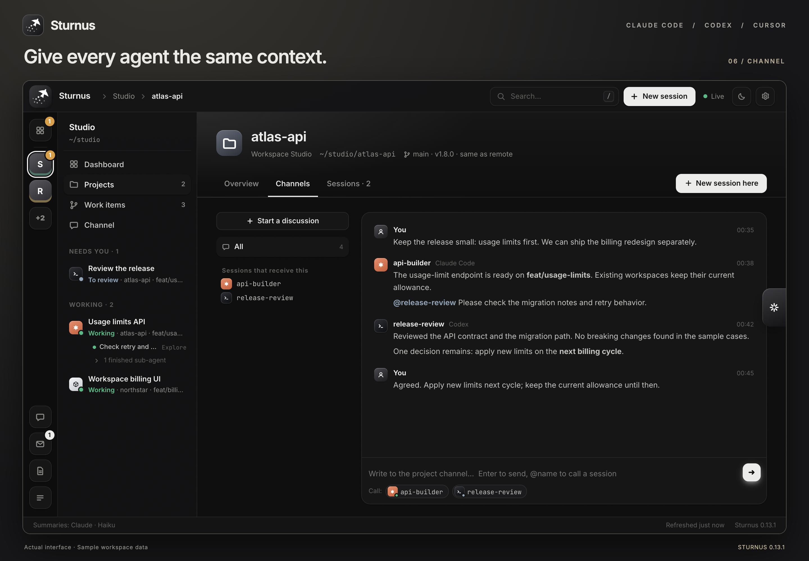

<div align="center">
  
  <h1>Sturnus</h1>
  <p><strong>多个编码 Agent，一个工作区。</strong></p>
  <p>看清谁在等你、工作做到哪里，随时接上正确的对话。</p>
  <p><a href="README.md">English</a> · <strong>中文</strong></p>
  <p><a href="#快速开始">快速开始</a> · <a href="#看看实际操作">操作演示</a> · <a href="docs/operations.md">安装与运维</a></p>
</div>



Sturnus 把同一台机器上的 **Claude Code、Codex 和 Cursor** 会话集中到一个浏览器界面，将对话与项目、worktree、分支和共享讨论关联起来。不用逐个打开终端，就能找到需要你处理的事情。

当几个 Agent 同时在不同仓库里工作——一个实现 API，一个检查同一条分支，另一个开发界面——Sturnus 帮你看清它们的进展，并接着安排下一步。

**Linux 与 macOS · Python 标准库 · Zellij 与 tmux · 中英文界面**

> 项目仍在积极开发中。以下素材来自 **0.13.1 的真实界面**，使用虚构的示例工作区数据。演示展示页面操作，不运行 Agent，也不发送消息。[演示说明与文字版 →](docs/demo.md)

## 看看实际操作

**工作区 → 工作项 → 会话 → 报告 → 搜索 → 项目讨论。**

下方 GIF 为 18 秒的 2 倍速预览，完整视频按正常速度播放。

[](https://github.com/ethannortharc/sturnus/blob/main/docs/media/v0.13.1/walkthrough.mp4)

[观看或下载完整 MP4](https://github.com/ethannortharc/sturnus/blob/main/docs/media/v0.13.1/walkthrough.mp4) · 36 秒 · 无声，附画面章节说明 · [文字版操作路线](docs/demo.md)

## 从「谁在等我」到下一步行动

### 1. 先看需要你处理的事

工作区仪表盘最上面是**现在在做的事**：助手按在做的事把会话归在一起，说明每件事做到哪一步，列出做这件事的会话、它们的状态和最后动静，点一下进入会话或它的终端。接下来是等待决定、遇到阻碍和需要验收的工作。下方的工作项展示分支进度和未提交文件，会话卡片说明每个 Agent 正在做什么。

最左侧切换工作区，相邻的一栏跟随当前工作区，把会话排成一个列表：工作中且等你确认的在最前，其次是工作中，再其次是等你，最后是空闲；同一状态里顺序固定，工作中的会话不会换来换去。列表上方可以筛选只看某一种状态。子 Agent 列在所属会话下面，可以查看它们的活动和对话记录。

### 2. 会话结束，工作仍然可追踪

一个**工作项就是一个 worktree 和它的分支**。项目页面将工作项、参与会话、最近的决定和报告中的产出放在一起。你既能看到两个 Agent 正在同一条分支上协作，也能找到已经没有会话、却还没合并的工作。



打开会话后，可以阅读**概览、对话和报告**，通过**终端**标签继续操作，或用**在本机终端里切过去**切换到已连接终端中的对应窗格。在网页终端里复制的内容会进你正在浏览的这台电脑的剪贴板：Zellij 里用鼠标选中、tmux 的复制模式、Claude Code 自己的复制都算（Zellij 配了 `copy_command` 的话，只复制到它所在的机器）。按住 ⌥（其他系统按 ⇧）拖动，可以直接在网页里选中，再按 ⌘C 复制。报告汇总目标、当前状态和下一步，附一条按你每次要求分段的时间线（做成了什么、定下了什么、产出了什么），以及按主题归并的决定：每个主题只留现在算数的结论，被它推翻的旧说法收在下面。

会话可以一边接着干活、一边等你回答。这时它标成**工作中 · 等你确认**，它问你的事连同原话一直列在概览和对话页的右侧，直到你点「已处理」，或者它之后的总结看出你已经回应。

### 3. 把下一条指令放在正确的位置

直接给一个会话写指令，把工作排到稍后，或者在项目讨论区给多个 Agent 补充共同的背景。助手可以根据各会话正在做的事，建议由谁接手，或是否新建一个会话。



| 给会话发送指令时 | 处理方式 |
|---|---|
| 在 Zellij / tmux 中空闲 | 输入到对应终端 |
| 正在工作 | 等这一轮结束，除非你明确选择立即发送 |
| 停在权限或选项提示上 | 不会把指令误输入到提示里 |
| 不在托管终端中 | 放入该会话的邮箱 |
| 已结束或离开 | 提示会话不可用 |

排队的工作可以在条件满足后自动发送，也可以先提醒你确认。自动模式下，助手会在发送前重新检查任务是否适合继续。

## 快速开始

需要 **Linux 或 macOS、Python 3.9+**，以及已安装的编码 Agent CLI。终端管理使用 **Zellij 或 tmux**。Sturnus 服务没有 pip 依赖；摘要和助手功能使用单独配置的模型。

```sh
git clone https://github.com/ethannortharc/sturnus.git
cd sturnus
./sturnus install
```

安装程序会把 `sturnus` 和 `amail` 加入 `~/.local/bin`，安装 Agent hooks 与 Zellij 插件，并启动用户服务。请确保 `~/.local/bin` 已加入 `PATH`。

```sh
sturnus open    # 打开仪表盘
sturnus token   # 查看浏览器首次登录需要的令牌
sturnus status  # 查看服务状态与访问地址
```

1. 打开 [127.0.0.1:7788](http://127.0.0.1:7788)，用令牌登录。
2. 在项目里开始或继续一个 Agent 会话。默认情况下，仓库的上级文件夹成为工作区。
3. 在**设置 → 助手与模型**中选择摘要和助手使用的模型。默认通过本机 Claude CLI 分别使用 Haiku 和 Sonnet，用的是 Claude Code 会话自己保持有效的登录 `~/.claude/.credentials.json`（在 macOS 上，后台服务否则会去读登录钥匙串，而 Zellij 里的会话读不到钥匙串，钥匙串里那份就会过期）。
4. 在**设置 → 显示**中选择中英文界面。**Agent 的工作语言**单独设置，决定之后生成的摘要、报告、回答和草稿使用哪种语言。

也可以下载 [Release 压缩包](https://github.com/ethannortharc/sturnus/releases)安装。升级、服务路径、远程访问和卸载见[安装与运维指南](docs/operations.md)。

## 五个概念

| 概念 | 含义 |
|---|---|
| **工作区** | 存放多个项目的文件夹，例如 `~/projects` |
| **项目** | 一个 Git 仓库及其全部 worktree，或一个普通文件夹 |
| **工作项** | 一个 worktree 和它的分支，生命周期独立于会话 |
| **会话** | 一场 Claude Code、Codex 或 Cursor 对话 |
| **讨论区** | 工作区或项目共享的讨论空间 |

会话归属它启动时所在目录的工作区和项目，之后进到别的目录干活也不变；工作项跟着它所在的 worktree 走。会话如果从工作区顶层启动，Sturnus 会根据它在这个工作区里操作的文件推断所属项目。在所有工作区之外启动的会话，跟着启动它的会话，或者它所在组里的其他会话。也可以在会话页面手动调整归属。

## 常用快捷操作

| 快捷键 | 操作 |
|---|---|
| `⌘/Ctrl K` 或 `/` | 搜索工作区、项目和会话 |
| 搜索中按 `Enter` | 打开选中结果 |
| 搜索中按 `⌘/Ctrl Enter` | 打开选中会话的网页终端 |
| `⌘/Ctrl 1–9` | 切换到左侧对应工作区 |
| `⌘/Ctrl B` | 收起或展开相邻一栏 |
| `⌘/Ctrl J` | 打开助手 |
| `N` | 新建会话 |
| 会话页面按 `T` / `C` / `O` | 终端 / 对话 / 概览 |

单键快捷键在没有输入文字时生效。双击侧栏里的会话，也能直接打开它的网页终端。

## 比会话活得久的任务

会话是临时的，它在推进的事不是。每个项目和工作区都有一份任务列表，在**任务**页、项目页和工作区仪表盘上以列表和卡片显示。每个任务记着现状、从哪接着做、定下来的事、产出，以及做过它的会话。有会话在做时显示进行中，会话结束后显示待继续。

- 可以从任务开一个新会话，交给正在运行的会话，也可以在会话页选一个任务。
- 会话用 `amail task` 维护自己的任务，开始时也会收到这个项目没做完的任务。
- 助手从每个会话的报告里补上遗漏，不覆盖你写的内容，列表变长时还会整理。
- 搜索覆盖任务、决定和产出，也包括已结束的。更新是替换原有内容，所以数据不会一直变大。详见[运维文档](docs/operations.md#tasks)。

## 用 amail 共享上下文

在项目目录里运行：

```sh
amail post "API 契约已准备好，可以检查了。"
amail post "@reviewer 请检查重试逻辑。"
amail topic "重试策略" --invite backend,reviewer
amail read
amail topics
```

普通帖子会在项目会话下一轮开始时送达；讨论区很忙时，一轮开始只完整给出点名它的、你发的和它参加的讨论，其余只给最新的几条，再报一个总数。`@名字` 可以在会话工作时提醒它，空闲时唤醒它；`@all` 会提醒整个讨论区。超过 12 个会话的讨论区里，会话发的 `@all` 不再唤醒所有人，等大家下一轮开始时送到；你发的 `@all` 照旧叫所有人。邀请制讨论默认在 24 条帖子后关闭，也可以主动结束。项目的**讨论**标签展示同一份内容。运行 `amail help` 查看全部命令。

## 在手机上处理

`/api/phone/summary` 和 `/api/phone/inbox` 列出等你处理的事：停在确认提示上的会话、停在提问上的会话、等你回话的会话。`POST /api/phone/actions/<id>`（`{"choice": …, "text": …}`）处理其中一项，登录方式和网页相同，所以打开网页的手机 App 也能在自己的界面里列出并处理它们。

- 确认提示会写明它要做什么（命令、文件、网址），可以允许或拒绝：允许按 `1`（总是第一个选项「Yes」），拒绝按 Esc。会改变长期规则的选项，比如「总是允许」或切换到自动模式，只能在终端里选。
- 只有一个答案的提问会给出选项；多个问题、多选、待批准的计划和 Codex 的提示只能打开去处理。
- 只有 Claude Code 自己说这个会话在等、它的进程现在就在那个窗格里、并且只开着一个提示时，才提供按键。每次回答都指明它看到的那个提示，按键发出前再查一次；那个提示已经被回答（在这里或终端里）或换掉了，就拒绝这次回答，同一项的第二次回答也拒绝，所以迟到的点按不会打出任何字。
- 给等着的会话写的话，和网页上一样送达：空闲时直接输入，工作中先存着，不在任何窗格里就发邮件。

屏幕宽度不到 640 px（手机）时，网页换成手机专用的排版：首页是一条列表（需要你的事，确认提示的允许和拒绝就在卡片上；在做的事，按工作区分组；空闲的会话、没做完的任务和所有工作区折叠起来），其他地方都在菜单里；会话页的头部和回复框固定。终端标签只看不打字：它显示 agent 自己那个窗格现在的画面，每两秒刷新，不挂客户端，所以桌面上的布局不会被缩小；要打字就点「接管终端」，这是单独的一步，会先说明后果。

## 模型、数据与访问

Sturnus 在本机运行，读取本地 Agent 活动和 Git 状态。**摘要、报告和助手请求会把相关上下文发送给你配置的模型**，模型可能运行在远程服务上。支持 Claude Code、Codex、pi 和 OpenAI 兼容 API。可选的语音输入会把录音发送给你选择的转写服务。

配置位于 `~/.config/sturnus/config.json`。通过设置页面保存的 API key 单独存放在本地 `secrets.json` 中，创建文件时使用 `600` 权限。浏览器访问需要登录令牌。

需要跨设备使用时，可以通过自己账号下的 Tailscale 设备访问。设置 `"tailnet": false` 可限制为本机访问。详见[模型与设置](docs/operations.md#settings)、[Tailscale 和 HTTPS](docs/operations.md#from-another-computer)、[隔离开发实例](docs/operations.md#trying-a-change)。

## 许可证

[MIT](LICENSE)。内置 xterm.js 使用 MIT；内置字体使用 [SIL Open Font License](web/fonts/OFL.txt)。

© 2026 Ethan H.B. Zhou
